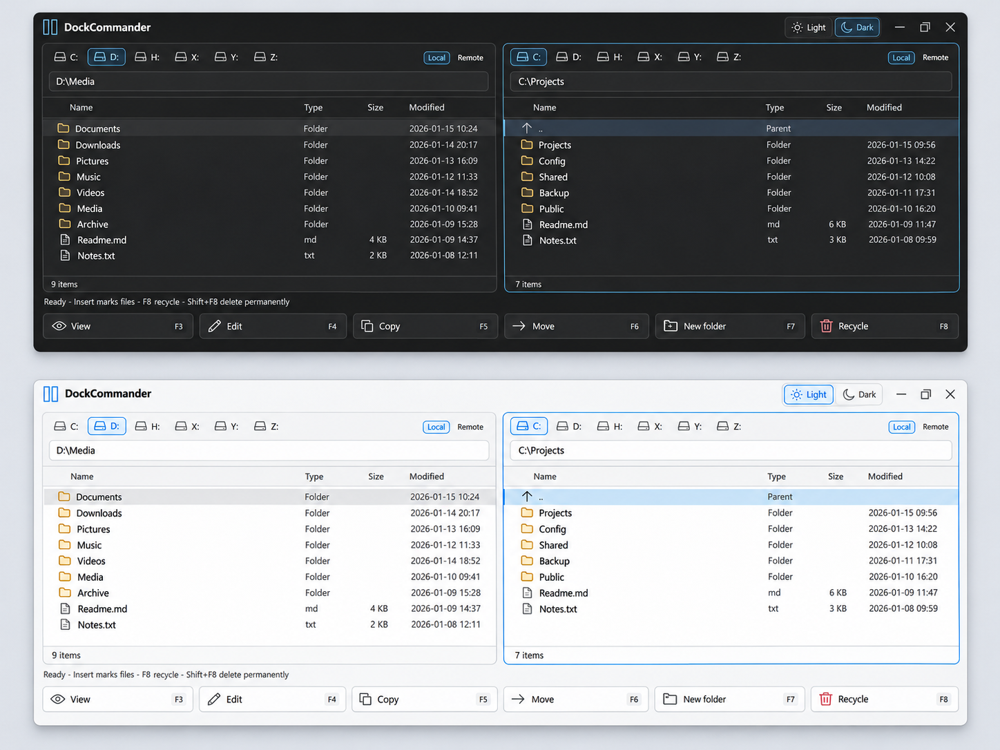

# DockCommander

Minimal, keyboard-first, dual-pane file manager inspired by Total Commander's workflow.
Windows is the first supported platform. C# / .NET 10 and Avalonia 12.1.2 keep the UI and
filesystem contracts portable. The Windows executable is **DC.exe**.

## Screenshots

DockCommander in dark and light themes.



## Build and run

Install the .NET 10 SDK for development:

```powershell
dotnet restore DockCommander.slnx
dotnet build DockCommander.slnx
dotnet run --project src/DockCommander.App
dotnet test DockCommander.slnx
```

GitHub Actions runs that test suite on Windows and Ubuntu 24.04, and publishes the
framework-dependent `win-x64` and `linux-x64` archives as workflow artifacts.
A version tag also attaches those archives, and the Debian package, to the [GitHub release](https://github.com/marchkov/DockCommander/releases).
See [CHANGELOG.md](CHANGELOG.md).

For sandboxed builds that cannot write Avalonia's build telemetry log, set
`$env:AVALONIA_TELEMETRY_OPTOUT = '1'` in that shell before building.
See [Avalonia's build telemetry documentation](https://github.com/AvaloniaUI/Avalonia/wiki/Telemetry).

Create a Windows x64 release without bundling .NET:

```powershell
dotnet publish src/DockCommander.App -c Release -r win-x64 --self-contained false -o artifacts/win-x64
.\artifacts\win-x64\DC.exe
```

Keep the published files together. This is a folder distribution, not a standalone EXE.
No runtime is bundled. The required framework is **Microsoft.NETCore.App 10, x64**.
On Windows, the .NET 10 Desktop Runtime x64 includes that framework and is the download to use.
On Debian/Ubuntu, install the package `dotnet-runtime-10.0`. A 32-bit or ARM64 runtime is not accepted.
The installer also accepts a non-standard x64 `dotnet` host, including one selected with `DOTNET_ROOT`,
when `dotnet --list-runtimes` lists Microsoft.NETCore.App 10.

```powershell
powershell -File packaging/windows/install.ps1 -Source artifacts/win-x64
```

```sh
sh packaging/linux/install.sh
```

The Windows script copies the folder to `%LOCALAPPDATA%\DockCommander`, records the copied files,
and adds a Start menu shortcut. Running it again updates that copy and removes files that belonged
to the previous copy. `packaging/windows/uninstall.ps1` removes only the recorded files and the
matching shortcut. Anything else in the folder is left in place. A folder that merely contains
`DC.exe` is not an installation and is not deleted. There is no separate Windows GUI installer:
the PowerShell script is the installer, and it does not embed .NET.

The Linux script installs into `~/.local/share/dockcommander`, writes `~/.local/bin/dc`, and adds
a DockCommander entry to the application menu. `packaging/linux/uninstall.sh` removes that recorded
copy. `packaging/linux/build-deb.sh` builds a `.deb` that depends on `dotnet-runtime-10.0` and the
native libraries, and installs the same menu entry for all users.

macOS is experimental and only for Apple Silicon. The `.dmg` bundles the .NET runtime, is ad-hoc signed, and is not notarized. It is not a stable platform. Install and first-launch notes are in [docs/MACOS.md](docs/MACOS.md).

## Implemented

- Two equal panes with independent drive buttons and editable paths.
- Compact location buttons with full-path tooltips and an adaptive «More ▾» overflow menu.
  Linux includes home/root shortcuts and hides system mounts; WSL drives use C:/D: labels.
  macOS lists Home, the filesystem root, and mounted volumes under `/Volumes`.
- Light and dark themes with a compact toolbar switch; the choice is saved on close.
- Integrated title bar with custom minimize, maximize/restore and close buttons.
  Drag its empty area to move the window; double-click to maximize/restore; drag edges to resize.
- Vector folder/file/action icons, coordinated panel colors, and distinct active/inactive selection.
- Compact Name / Type / Size / Modified columns; directories before files.
- Restrained active-pane border, local timestamps, preserved cursor and marks on refresh.
- Each pane has its own `Local | Remote` switch. Remote profiles can open SFTP, FTP, FTPS, or WebDAV
  in either pane. WebDAV is one provider. Its type (Nextcloud, ownCloud, Synology, QNAP, or Generic)
  only builds the server address; it is not a separate implementation. An open remote session can be
  shared by both panes and is kept alive when a pane temporarily switches back to Local.
- Cross-provider copy and move use the same transfer queue, progress, cancellation, and conflicts
  as local operations. Local ↔ Remote and Remote ↔ Remote are supported.
- Local recursive copy and move through an operation service, outside the UI thread.
  Confirmed copies and moves enter a queue. One runs at a time; further copies and moves can be
  queued while the panes stay usable. Waiting items can be removed. Esc cancels the running transfer.
  Delete, rename, and new folder can run while a transfer is still going.
- Copy/move progress below the panes shows both the whole batch and the current file.
  A cancellable scan counts files and bytes before any changes. Overall progress includes
  skipped files as processed work and displays their count separately; it is not a count
  of bytes physically copied. Unknown sizes use file-count progress instead.
  Totals reflect the initial scan; files modified externally during transfer can differ.
  Cancel or Escape requests cancellation; completed files remain in place.
- Confirmation before copy, move, and deletion.
- Operation dialogs use custom frameless headers and follow the current theme.
  The confirmation button starts focused: Enter accepts, Escape or the close button cancels.
  Conflict dialogs default to Overwrite/Merge, or Skip when replacement is unavailable.
- Conflict choices: overwrite, skip, rename incoming entry, cancel.
  Existing folders can be merged; conflicting files inside are asked about separately.
  A file cannot overwrite a directory or vice versa.
- F7 directory-name prompt.
- F8 uses the Windows recycle bin or Linux GIO trash. On a pane with no recycle bin, including every remote connection, F8 asks to delete permanently. Shift+F8 always deletes permanently.
- Errors stay in the status bar; hover over the status text to read a long message.
- Paths, normal window size, maximized state, and active pane are saved on close.

## Keyboard and selection

| Key | Action |
| --- | --- |
| Tab / Shift+Tab | Switch pane |
| Arrows / Home / End / Page Up / Page Down | Move cursor |
| Enter / double-click | Open file with its system application, or enter directory |
| F3 | Read-only text viewer |
| F4 | Edit the current text file. Another file opens in its system application |
| Shift+F4 | Create a file in the current folder and open it in the editor |
| Ctrl+Shift+F4 | Choose the external editor; empty value restores the platform default |
| Ctrl+L | Edit the active path; Enter opens it |
| Ctrl+Shift+T | Toggle light/dark theme |
| Ctrl+R | Refresh active pane and drive buttons |
| Ctrl+F / Alt+F7 | Find files by name from the current directory |
| Space | Calculate the size of the current directory |
| Insert | Toggle current entry's mark and advance |
| Num + / Num - | Mark / unmark files by mask |
| Num * | Invert file marks |
| Alt+F1 / Alt+F2 | Choose a location for the left / right pane |
| Ctrl+Space / Ctrl+click | Toggle a mark |
| Shift+Up / Shift+Down / Shift+click | Mark a range |
| F5 | Copy to the opposite pane |
| F6 | Move to the opposite pane |
| Shift+F6 | Rename current file or directory |
| F7 | Create directory |
| F8 | Move selected entries to the recycle bin, after confirmation. On a pane with no recycle bin, delete permanently after confirmation |
| Shift+F8 | Delete permanently, after separate confirmation |
| Esc | Cancel a dialog, or cancel the transfer that is running. Waiting transfers stay queued |

A dot marks selected entries independently of the cursor. Copy, move and delete use all marked entries;
if none are marked, they use the current row. The parent row is never operated on.
Marks survive pane switching and refresh when the entries still exist.
Open, view, edit and rename use the current row regardless of marks.
Numpad selection affects files only and preserves folder marks and the cursor.
Masks are case-insensitive: `*` matches any text, `?` one character, and `;` separates
patterns (for example `*.txt;*.md`). Both `*` and `*.*` include extensionless files.
Find Files matches names only, using the provider's path comparison. `*` and `?` are wildcards, and `;` separates patterns.
Esc cancels a running search and keeps the results. It does not search file contents. In the built-in editor, Ctrl+F still searches the open document.
Space on a directory fills its Size cell; Space on a file does nothing extra. Ctrl+Space still toggles a mark.
These shortcuts do not intercept typing in the path field. In the location chooser,
use arrows and Enter; Escape keeps the current paths and active pane.

F3 previews up to 256 KiB of text and never writes the file. A longer preview is marked as truncated.
F4 edits a whole text file up to 1 MiB. A binary file, or a file above that limit, is handed to the system and opens in its default application when the file has a local path.
Both understand a byte-order mark, UTF-8, UTF-16, UTF-32, and can save Windows-1250, Windows-1251, or ISO-8859-1 when that encoding is selected.
Bytes that are not valid UTF-8 and contain no binary control characters are shown as a guessed Windows-1251 text so another encoding can be chosen.
Obvious binary data, including a NUL, is rejected.
The editor saves with Ctrl+S, tracks unsaved changes, and asks Save, Don't Save, or Cancel before closing a modified file.
Escape closes the editor through those same rules. Ctrl+F finds the next or previous match, and Escape closes the find bar first.
The status line shows the line, column, encoding, and line-ending style. Changing the encoding changes the next save. Reload rereads the file through the same provider, using the selected encoding, and does not replace unsaved edits. If that read fails, the open text stays as it is.
Shift+F4 asks for a file name, creates an empty file in the current folder, and opens it in the editor. The same command is on the right-click menu. It uses the folder's file provider, including a remote connection.
The external editor remains on the file menu. It defaults to Notepad on Windows.
Linux requires an editor configured with Ctrl+Shift+F4. Specify an executable path or command without arguments or surrounding quotes.
Use Ctrl+R after saving changes in the external editor.

## Mouse

- Windows: Shift + right-click opens the classic Windows Shell context menu for the
  clicked file or marked selection. The menu follows the app's light/dark theme on
  supported Windows versions; Windows high contrast takes priority.
  On empty space it opens the folder background menu;
  the parent row (`..`) is excluded. It is unavailable while transfers are queued.
  Shell commands run outside DockCommander's transfer queue; both panes refresh after
  the menu command returns. Linux keeps the existing DockCommander menu.
- Each pane has its own Local | Remote switch. Local is the file list. Remote shows saved
  connections, search, and Add connection. Connect, or a double-click on the connection row, opens SFTP, FTP, or FTPS in that pane.
  WebDAV asks for a type and a server URL. Nextcloud and ownCloud add their DAV path, including a subdirectory install.
  ownCloud tries `/remote.php/dav/files/<user>/` and, if that is missing, `/remote.php/webdav/`.
  Synology, QNAP, and Generic use the URL as entered. HTTPS is the default, and port 80 stays plain HTTP.
  FTPS uses explicit TLS, and port 990 uses implicit TLS.
  The password or private key can be remembered. It is encrypted for this user account and is not
  written as plain text. If the connection fails, the sign-in window opens again. Anonymous FTP connects without a password prompt. Switching a pane to Local
  keeps the session, and Remote returns to it. A new connection stays open beside the earlier one,
  with the newest name on the left. Both panes list every open connection and can show different ones.
  A plus button beside the connection opens the saved connection list without closing
  the session. The server key or certificate is confirmed once for that connection and asked again
  only if it changes.
  F3 can view a remote text file, and F4 can edit one through the same connection. Opening it in an external program still needs a local file.
  WebDAV can replace an existing file in one step. SFTP and FTP write a temporary file, delete the destination, and then rename. If that rename fails, the original file may already be gone; a failed upload leaves it in place.
  A live connection shows Connected. Disconnect keeps the profile and the saved sign-in, and the name stays as Disconnected until Reconnect or Close.
  If the server drops the connection, the session becomes Disconnected. Forget sign-in removes only the saved password or key. Several connections can stay open, and disconnecting one leaves the others alone.
- Click selects the current row; double-click opens a file or directory.
- Ctrl+click toggles a mark; Shift+click marks a range.
- Right-click opens the action menu for the clicked row. Right-clicking a marked row
  keeps the group; an unmarked row clears the old marks. Empty space keeps the current
  marks and cursor, and offers only folder creation and refresh.
- Drag a row to the other pane to copy; hold Shift to move. This works between Local and Remote
  and between two remote connections. Dragging a marked row
  transfers the marked group; an unmarked row transfers only itself.
- Drop on a folder row (including `..`) to target that folder, or on other space in
  the file list to target the pane's current directory. The target is highlighted.
- Dropping still asks for confirmation and uses normal conflicts, progress and cancellation.
  Dragging within one pane is not supported. Dragging out includes the local file paths,
  so Explorer and other file managers can copy or move them. A move performed outside
  DockCommander refreshes the source pane.
- Drop local files/folders from Explorer or a Linux file manager into a pane or folder
  to copy them, including into an open remote connection. External drops always copy (even with Shift); originals are retained.
  Confirmation, conflicts, progress and cancellation are the same as F5. Duplicate
  paths and explicitly selected children of a selected folder are processed only once.
  Virtual/cloud-only items without a local path are not accepted.

## Settings

Settings use `Environment.SpecialFolder.ApplicationData/DockCommander/settings.json`.
On Windows this is normally `%APPDATA%\DockCommander\settings.json`.
Invalid settings fall back to defaults; unavailable saved paths fall back to the home directory.
The optional `Theme` setting is `Light` or `Dark`; existing settings without it use the light theme.
`EditorExecutable` stores the optional external editor, saved on close.
Saved remote profiles live in `connections.json`. Remembered sign-in data is stored separately
in `connections.secrets.json` and encrypted for the current user: Windows uses DPAPI CurrentUser;
Linux uses an application key restricted to the user account. Server trust is stored per connection
and must be confirmed again when the SFTP host key or FTPS certificate fingerprint changes.
Dialogs follow the main window's theme. Theme colors and styles live in
`src/DockCommander.App/Styles.axaml`.

## Operation limits

- Recycling is supported on Windows and on Linux with `/usr/bin/gio` installed.
  A pane that cannot recycle, including every remote connection, asks for permanent deletion instead of reporting an error.
  A recycle that fails is never turned into a permanent deletion.
- Windows also refuses a recycle request when the Shell would delete permanently
  (for example, on an unsupported volume). Shift+F8 is always a separate explicit action.
- Copying/moving into the source itself is rejected.
- Symbolic links and junctions can be listed and navigated. Copy and a file-by-file move
  skip the link and continue with the rest of the tree; the link target is not followed.
  Moving a whole folder onto a path that does not exist yet renames the folder when the
  volume allows it, so links inside move with the folder. Permanent deletion still refuses
  the selection when a link or a Windows read-only file is present. A failure after removal
  has started names the entries already deleted.
- A failed or cancelled batch keeps already completed changes; there is no rollback.
  Skipped move entries remain at the source. Cancellation is checked between entries and
  during each buffered file copy. A native same-volume move of a file or of a whole folder
  cannot be interrupted mid-call. A folder rename is used only when the destination path
  does not exist yet; merges and cross-volume moves still walk file by file.
  Cancellation removes the unfinished staged copy and preserves the previous destination.
  Cross-drive moves commit the copy before deleting the source; a failed source deletion may leave both copies.
- Copies are staged beside the destination before replacing an existing file.
  A process crash may leave a clearly named `.dc-*.tmp` file.
- One transfer runs at a time. More copies and moves wait in the queue. Delete, rename, and new folder
  are refused while that queue is not empty.
- Cross-provider transfers stream through provider capabilities. A move across providers copies first,
  then deletes the source; a failure after the copy can therefore leave both copies.
- F3 and the built-in F4 editor read and write through the provider stream, including a remote connection.
  A provider that cannot write file content can still be viewed. A remote file that is not text cannot be handed to a local application. The external editor still needs a local file.

## Tests

The suite covers filesystem operations, conflicts, cancellation, deletion routing, selection,
navigation, keyboard dialogs, focus restoration, and settings persistence.
Tests use isolated temporary directories.

The optional Windows integration test creates one disposable file and sends it to the real
Windows recycle bin. It leaves that test file in the bin and does not empty it:

```powershell
$env:DC_TEST_RECYCLE = '1'
dotnet test DockCommander.slnx --filter Category=WindowsIntegration
Remove-Item Env:DC_TEST_RECYCLE
```

Run this test in a normal Windows session; a restricted sandbox may make recycling unavailable.

## Architecture and next milestone

See the [current roadmap and audit](docs/ROADMAP.md) for completed work and remaining priorities.

- `DockCommander.Core`: provider/plugin contracts, local filesystem provider, operation service;
  no Avalonia dependency.
- `DockCommander.App`: panes, dialogs, settings, composition, Windows recycle-bin adapter.
- [Provider lifecycle and guarantees](docs/PLUGIN_API.md).

Supported systems are Windows and Debian/Ubuntu. Copy and move are queued, and the installers
check for the .NET 10 x64 runtime. SFTP, FTP, FTPS, and one generic WebDAV provider are implemented through the same
transfer model as local files. WebDAV types are address presets, not separate providers. Dynamic external plugin
loading and archive providers remain later work.

The active solution is `DockCommander.slnx` in the repository root.

Linux x64 builds and GIO trash support are available. See [Debian/Ubuntu setup](docs/LINUX.md).

## License

[MIT](LICENSE). Copyright (c) 2026 Denis Marchkov.
